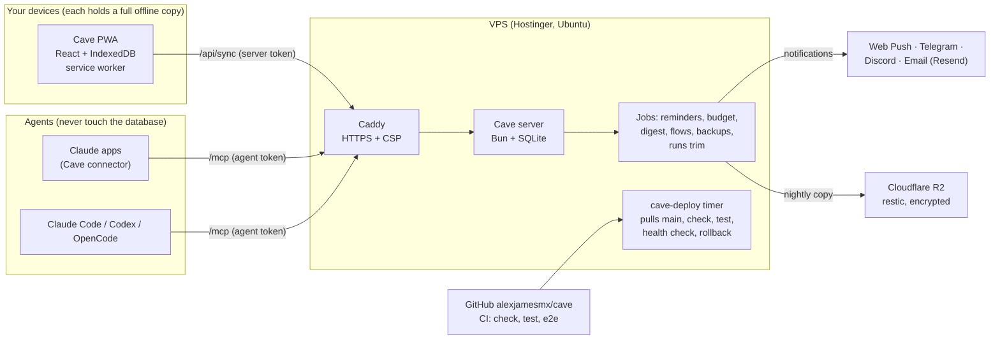
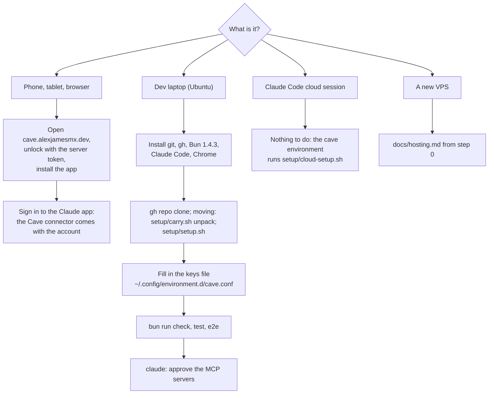

# Onboarding

How the Cave fits together and how any machine joins it. Details live in the linked docs; this page is the map.

## The system



- **Data:** SQLite on the VPS is the hub. Every device syncs a full copy (`docs/architecture.md`, "Sync protocol"); offline works.
- **Code:** GitHub. A push to `main` deploys within minutes if `check` and `test` pass on the VPS; a failed health check rolls back.
- **Agents:** only through `/mcp` with their own token. Every write is logged and undoable.
- **No model runs in the Cave, and no chat.** Agents come in through MCP (`docs/decisions.md`, M10, M13).

## Onboard a machine



### Phone, tablet or browser
1. Open `https://cave.alexjamesmx.dev`, unlock with the server token, install the app (iPhone: Share → Add to Home Screen; notifications work only there).
2. The token is kept on the device. It is asked again only after Lock this device, a token change on the server, or the browser clearing the site's data.
3. Sign in to the Claude app; the Cave connector is part of the account (`docs/agents.md`, "Claude apps").

### Development laptop (Ubuntu)
```bash
sudo apt install git gh build-essential shellcheck
curl -fsSL https://bun.com/install | bash -s bun-v1.4.3
curl -fsSL https://claude.ai/install.sh | bash          # run claude once to log in
curl -fsSLO https://dl.google.com/linux/direct/google-chrome-stable_current_amd64.deb
sudo apt install ./google-chrome-stable_current_amd64.deb && rm google-chrome-stable_current_amd64.deb
gh auth login && gh repo clone alexjamesmx/cave ~/code/jarvis && cd ~/code/jarvis
setup/setup.sh                                        # hooks, bun install, global rules, Playwright MCP, plugins
bun run check && bun test && bun run e2e
```
Then fill in the keys file `setup/setup.sh` wrote (Keys, below), log out and back in, start `claude` in the checkout, approve the project MCP servers and check `/mcp`. SSH to the VPS, `.env` for the laptop tooling and Remote Control: `docs/system.md` section 6.

### Move to a new laptop
Git and the VPS hold the code and the data. Only these live on the laptop:

| Path | What it holds | On the next laptop |
|---|---|---|
| `~/code/jarvis/.env` | laptop tooling: `CAVE_DB_PATH`, `CAVE_SSH`, `CAVE_REMOTE_URL`, `CAVE_REMOTE_TOKEN`, `BACKUP_PULL_DIR` | carried, or rebuilt from `.env.example` and the password manager (`docs/system.md` section 6) |
| `~/code/jarvis/data/` | the dev database and the backups pulled from the VPS | carried, or `bun run pull-data` again |
| `~/code/jarvis/.claude/settings.local.json` | this machine's permission mode | carried |
| `~/.ssh/` | `id_ed25519` (root on the VPS, and GitHub) and the `cave-vps` entry | carried, or a new key (`docs/system.md` section 6) |
| `~/.config/environment.d/cave.conf` | the agent token and the MCP keys (Keys, below) | carried; on WSL the packer writes it from the environment |
| `~/.claude/CLAUDE.md`, `~/.claude/settings.json` | Claude Code's user rules and settings | carried; unpack keeps any already there |
| `~/.claude/projects/-home-<user>-code-jarvis/memory/` (the checkout's path, every character but letters and digits as `-`) | Claude Code's memory of this project | carried, under the new checkout's path |
| `~/.config/systemd/user/cave-remote-control.service` | Remote Control | written again by `setup/setup.sh` |

1. **Old laptop:** push every branch (`git status` clean, `bun run wip` for unfinished work) and stop `bun run dev`. Run `setup/carry.sh pack <a folder on a USB drive>`: it writes one gpg-encrypted file. Keep its passphrase in the password manager, not next to the file.
2. **New laptop:** install the tools and clone (above), run `setup/carry.sh unpack <file>` in the new checkout, then `setup/setup.sh`. Unpack never overwrites; it lists what it kept.
3. Log out and back in, then check: `ssh cave-vps true`, `bun run check && bun test && bun run e2e`, `claude` and `/mcp`, and `systemctl --user status cave-remote-control`.
4. Optional: mint a new agent token for the new machine and revoke the old one (`docs/system.md` section 6, step 3).

### Claude Code cloud session
Nothing to install: the `cave` environment runs `setup/cloud-setup.sh`. It has no production access by design; it works on `bun run dev:seed` data.

## Keys

Every secret lives in an environment variable or a password manager, never in the repo.

| Key | Where it lives | What it is for | Needed by |
|---|---|---|---|
| Server token `CAVE_TOKEN` | `/etc/cave/cave.env`; password manager | unlocks the app on a device | every device |
| `CAVE_AGENT_TOKEN` | laptop `~/.config/environment.d/cave.conf` | Claude Code's `cave` MCP (`bun run agent add`, `docs/agents.md`) | laptop |
| `CONTEXT7_API_KEY`, `EXA_API_KEY`, `FIRECRAWL_API_KEY` | laptop `~/.config/environment.d/cave.conf` | library docs, web search, page scraping MCPs | laptop |
| `GITHUB_PAT` | laptop `~/.config/environment.d/cave.conf` | the GitHub MCP | laptop |
| `CAVE_REMOTE_TOKEN` (= server token), `CAVE_SSH`, `CAVE_REMOTE_URL` | laptop `.env` | `bun run deploy`, `bun run pull-data` | laptop |
| SSH key `~/.ssh/id_ed25519` | laptop | the VPS and GitHub | laptop |
| VAPID keys, Telegram bot token, Discord webhook | `/etc/cave/cave.env` | notification channels, each optional | VPS |
| `CAVE_RESEND_API_KEY`, `CAVE_EMAIL_FROM`, `CAVE_EMAIL_TO` | `/etc/cave/cave.env` | email and the daily digest | VPS |
| R2 keys and the restic password | `/etc/cave/offsite.env`, `/etc/cave/offsite.key`; password manager | encrypted off-box backups | VPS |
| Claude connector header (an agent token) | Claude account | the Cave in the Claude apps | Claude account |


## Costs

| Piece | Cost |
|---|---|
| VPS and domain (Hostinger) | your Hostinger plan; DNS records are free |
| Cloudflare R2 backups | within R2's free tier for a database this size |
| Email (Resend) | free up to 3,000 a month, 100 a day |
| Web Push, Telegram, Discord | free |
| GitHub (public repo, Actions) | free tier |
| Claude | your Claude subscription; the Cave calls no model, so no API key or usage bill |
| MCP keys (Context7, Exa, Firecrawl) | their free tiers; development only |

## Scale and limits

One owner, one VPS, SQLite. Sync is incremental (a cursor per device), so a device downloads only what changed. Growth points to watch: the `runs` collection (trimmed to 500 a day by a job), notes and pages (text, small), and the bundle size (`web/bundle.test.ts` holds a budget). A second owner or many writers would need a different design; that is a non-goal (`docs/decisions.md`).
