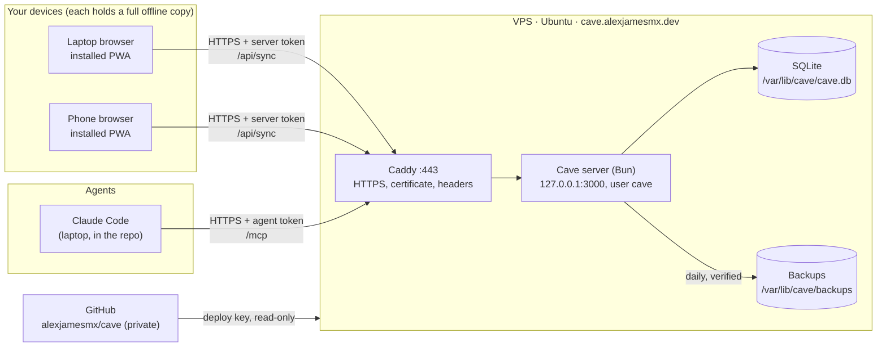
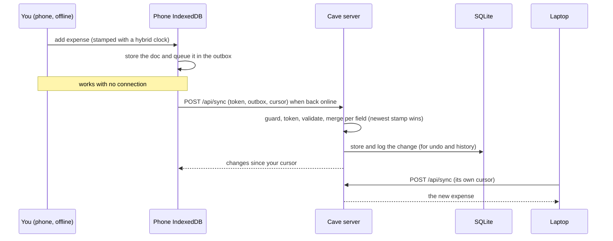
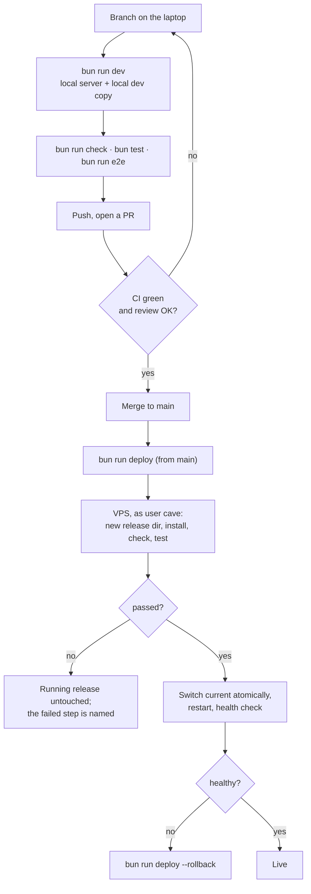
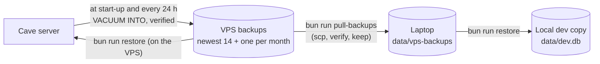

# How the Cave works

One page for the whole system: what runs where, how data and code move, how to work on it locally without touching production, and how to rebuild any piece from scratch. Details live in the files linked from each section.

## 1. The pieces



| Piece | Where | Job |
|---|---|---|
| PWA | each device's browser | the app; keeps a full copy in IndexedDB and works offline |
| Caddy | VPS, ports 80 and 443 | HTTPS with automatic Let's Encrypt certificates, security headers, forwarding to the server |
| Cave server | VPS, `127.0.0.1:3000` | sync hub, MCP server for agents, backups; never reachable directly from outside |
| SQLite | VPS, `/var/lib/cave` | the one server-side copy of every record |
| GitHub | cloud | the code; the VPS can only read it |
| Laptop repo | `C:\Users\sgale\projects\jarvis` | where code is written, tested and deployed from |

**Who gets in.** Every `/api` request needs the server token, and `/mcp` needs an agent token. Before any token check, the request guard refuses unknown hosts, foreign origins and non-JSON posts. The firewall lets in only 22, 80 and 443, and SSH takes keys only.

## 2. How a record moves (sync)



- **Every field merges on its own.** Edits to different fields of one record never overwrite each other. For the same field, the newer stamp wins.
- **Nothing is hard-deleted.** Deleting sets `_deleted`. Every change keeps its previous value, which is what undo uses.
- **Spec:** `docs/plan-v0.1.md`, "Sync protocol".

## 3. How code moves (develop, review, deploy)



- Only commits already on `origin/main` can be deployed.
- Each release lives in `/opt/cave/releases/<commit>`, and `current` points at the running one. Five are kept.
- **Details:** `deploy/release.sh`, `docs/hosting.md`.

## 4. How backups move



**Restore recovers a broken server; it doesn't undo edits.** After a restore, devices push back anything newer than the backup. To reverse a change, use undo on the Agents page or the item's history.

## 5. Working locally (no deploys while testing)

The local server and production never share data:
- the local app runs at `http://127.0.0.1:3000`, a different origin, so its IndexedDB is separate;
- the local database is a separate file.

**One-time setup on the laptop.** Add to `.env`:
```
CAVE_DB_PATH=data/dev.db
```

**Fresh dev copy of real data** (whenever you want one):
```powershell
bun run pull-backups                                  # newest verified VPS backups into data/vps-backups
bun run restore data/vps-backups/<newest>.db          # into data/dev.db (stop the local server first)
```

**Daily loop:**
```powershell
git switch -c <branch>
bun run dev                                           # http://127.0.0.1:3000, no token needed on loopback
bun run check; bun test; bun run e2e                  # e2e uses its own temp database
```

**Agents against the local server.** `.mcp.json` points `cave` at production. To try MCP changes locally, add a second entry `cave-dev` with URL `http://127.0.0.1:3000/mcp` and the same `${CAVE_AGENT_TOKEN}`. A restored dev copy contains the production agent tokens' hashes, so the same token works locally, but only if the backup is newer than the token. After minting a new agent token, take a fresh backup on the VPS first (`bun run backup` as `cave`, as in `docs/hosting.md`), then pull and restore.

**Rules:**
- Never point a local server at the VPS database, and never copy `data/dev.db` up to the VPS.
- Production changes go through PR, merge and `bun run deploy`.
- `data/` is git-ignored and Claude Code is denied access to it. Copies of real data stay on the laptop.

## 6. Recreate from scratch

### A new development laptop
1. **Tools:**
   - **Windows:** `setup/setup.cmd`. It installs Git, Bun, the GitHub CLI and Claude Code, and asks for the MCP keys.
   - **Linux or macOS:** install git, `gh`, Bun 1.4.3 (`curl -fsSL https://bun.com/install | bash -s bun-v1.4.3`) and Claude Code by hand.
2. **Code:**
   ```bash
   gh auth login
   gh repo clone alexjamesmx/cave
   cd cave
   git config core.hooksPath .githooks
   bun install && bun run check && bun test
   ```
3. **SSH to the VPS:**
   - Run `ssh-keygen -t ed25519` (with a passphrase).
   - In hPanel's browser terminal, append the new public key to `/root/.ssh/authorized_keys`.
   - Add to `~/.ssh/config`:
     ```
     Host cave-vps
       HostName 203.0.113.10
       User root
       IdentityFile ~/.ssh/id_ed25519
     ```
   - Run `ssh cave-vps true`. Check that the host key fingerprint matches `ssh-keygen -lf /etc/ssh/ssh_host_ed25519_key.pub` in the browser terminal.
4. **`.env`:** copy it from `.env.example`. Set:
   - `CAVE_DB_PATH=data/dev.db`;
   - `CAVE_REMOTE_URL=https://cave.alexjamesmx.dev`;
   - `CAVE_REMOTE_TOKEN` (the server token, from your password manager);
   - `BACKUP_PULL_DIR=data/vps-backups`;
   - `VAULT_PATH` if the vault is on this machine.
5. **Agent token:** one per machine.
   - In the browser terminal, run `bun run agent add claude-code-<machine> --scopes read,write` (the full command is in `docs/agents.md`).
   - Store the token as the user environment variable `CAVE_AGENT_TOKEN`, without putting it on a command line.
   - Revoke the old machine's token with `bun run agent revoke <name>`.
6. **Claude Code:** start `claude` in the repo, check `/mcp` shows `cave` connected, then make the dev copy (section 5).

### A new phone, tablet or browser
Open `https://cave.alexjamesmx.dev`, enter the server token in Settings, and install the app. The first sync downloads everything.

### A lost device
1. Replace the server token on the VPS:
   - edit `CAVE_TOKEN` in `/etc/cave/cave.env`, using the `printf` method from `docs/hosting.md` step 4;
   - run `systemctl restart cave`.
2. Enter the new token on your remaining devices.
3. Update `CAVE_REMOTE_TOKEN` in the laptop's `.env`.
4. If the device had an agent token, revoke it as well.

### A new VPS
1. Create the VPS with plain Ubuntu (no panel template) and your SSH key.
2. Point the `cave` A and AAAA records at it.
3. Run `docs/hosting.md` from step 0.
4. In step 9, restore the newest backup from `data/vps-backups` instead of the laptop database.
5. Generate a new server token, and new agent tokens if the old database is gone.

### The DNS records (hPanel, zone `alexjamesmx.dev`)
| Type | Name | Value |
|---|---|---|
| A | `cave` | VPS IPv4 (`203.0.113.10`) |
| AAAA | `cave` | VPS IPv6 (`2001:db8::10`) |

Don't touch the other records (portfolio, mail).

## 7. Secrets: where each lives

| Secret | Lives in | Never in |
|---|---|---|
| Server token `CAVE_TOKEN` | `/etc/cave/cave.env` (root:cave 640), your password manager, each device's Settings, the laptop `.env` as `CAVE_REMOTE_TOKEN` | git, logs, chats, command lines |
| Agent tokens | shown once at creation; the agent's environment variable (`CAVE_AGENT_TOKEN`); only their SHA-256 on the server | git, `.mcp.json` (it uses `${CAVE_AGENT_TOKEN}`) |
| SSH keys | `~/.ssh` on the laptop; the VPS deploy key in `/var/lib/cave/.ssh` | anywhere else |
| MCP keys (Context7, Exa, Firecrawl, GitHub) | user environment variables | git |

## 8. Where to look next
- `docs/plan-v0.1.md`: data model, sync protocol, milestones.
- `docs/hosting.md`: the server runbook.
- `docs/agents.md`: connecting Claude Code, Codex and OpenCode.
- `docs/decisions.md`: why things are the way they are.
- `docs/log/` and `docs/review/`: what was built and checked, milestone by milestone.
