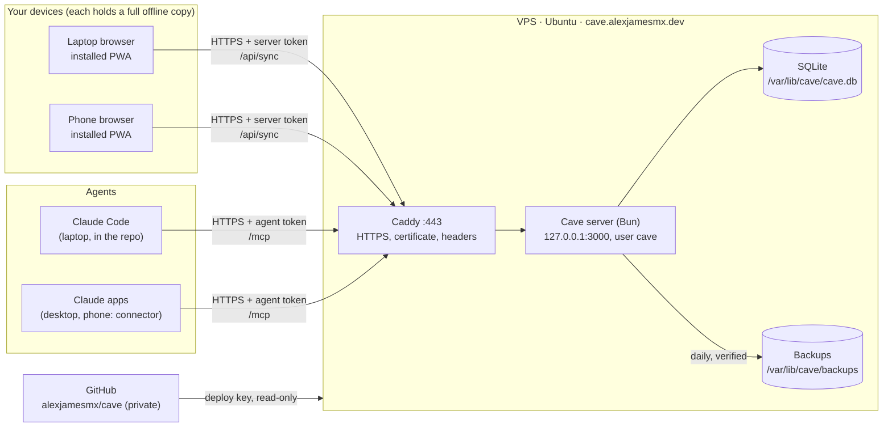
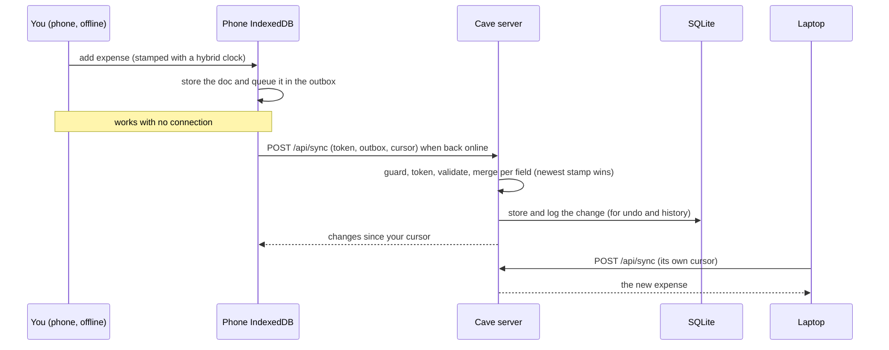
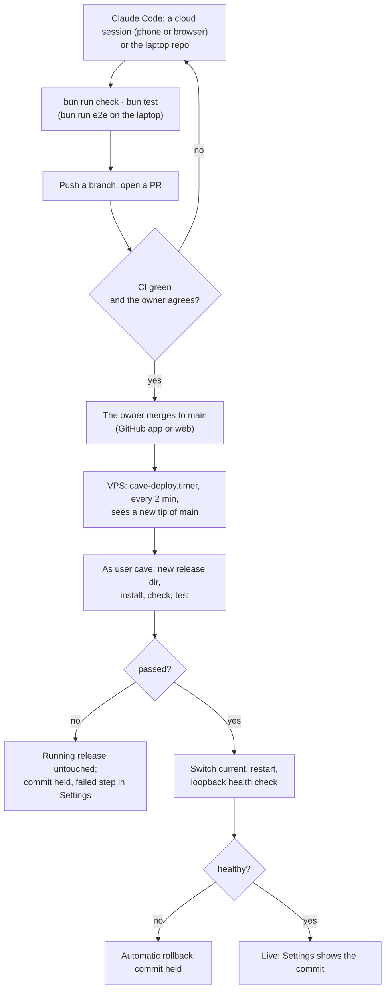
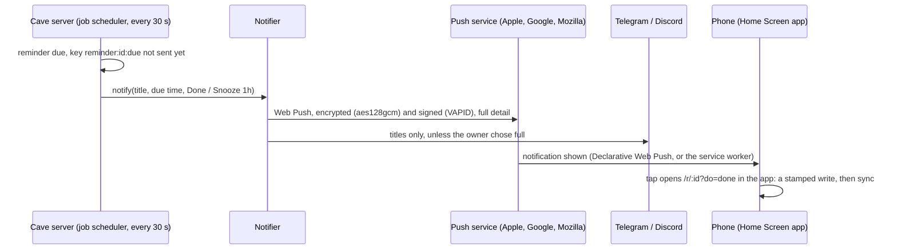
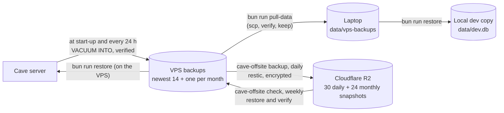

# How the Cave works

One page for the whole system: what runs where, how data and code move, how to work on it locally without touching production, and how to rebuild any piece from scratch. Details live in the files linked from each section.

## 1. The pieces



| Piece | Where | Job |
|---|---|---|
| PWA | each device's browser | the app; keeps a full copy in IndexedDB and works offline |
| Caddy | VPS, ports 80 and 443 | HTTPS with automatic Let's Encrypt certificates, security headers, forwarding to the server |
| Cave server | VPS, `127.0.0.1:3000` | sync hub, MCP server for agents, backups; never reachable directly from outside |
| SQLite | VPS, `/var/lib/cave` | the one server-side copy of every record |
| GitHub | cloud | the code; the VPS can only read it, and deploys the tip of `main` |
| Claude Code cloud sessions | Anthropic VM | change the code from the phone or browser; push branches and open PRs, never merge; no production access |
| Laptop repo | the laptop (Linux), `~/code/jarvis` | where code is written and tested; Remote Control and `bun run deploy` run from here |

**The app's structure** (M11): six sections (Money, Calendar, Flows, Projects, Diary, Tasks) and Settings, each with tabs, all from one registry (`web/src/app/sections.ts`) that the rail, the phone dock and the router read; the app opens on the Scene (Projects). Every collection belongs to one section or is reached only from Settings → Data. A project has its own page: Overview, Board, Diagram, Canvas (React Flow) and Activity (agents' runs); Projects → Activity lists every run; Settings holds only general things (General, Devices & server, Notifications, Agents, Data).

**Who gets in.** Every `/api` request needs the server token, and `/mcp` needs an agent token. Before any token check, the request guard refuses unknown hosts, foreign origins and non-JSON posts. The firewall lets in only 22, 80 and 443, and SSH takes keys only.

## 2. How a record moves (sync)



- **Every field merges on its own.** Edits to different fields of one record never overwrite each other. For the same field, the newer stamp wins.
- **Nothing is hard-deleted.** Deleting sets `_deleted`. Every change keeps its previous value, which is what undo uses.
- **Spec:** `docs/architecture.md`, "Sync protocol".

## 3. How code moves (develop, review, deploy)



- **Merging to `main` deploys.** Nothing on GitHub can stop a merge on a private repo with GitHub Free, so the gates are the owner's merge, the VPS re-running `check` and `test`, and the health check with automatic rollback.
- **One deploy path.** `/usr/local/sbin/cave-deploy` (root, installed by hand from `deploy/cave-deploy`) is the only thing that deploys. The timer runs `cave-deploy auto`; `bun run deploy` runs `cave-deploy now` over SSH, then checks the public URL.
- **A backup before every switch.** Each deploy first takes a verified backup with the running release's code, in `/var/lib/cave/backups/pre-deploy` (newest five kept). A rollback across a migration needs it: the older release refuses the newer schema (`docs/hosting.md`).
- **A held commit** (failed or rolled back) is skipped by the timer until `cave-deploy now` retries it or a newer commit lands on `main`.
- Each release lives in `/opt/cave/releases/<commit>`, and `current` points at the running one. Five are kept. The last result is in `/var/lib/cave-deploy/status.json`.
- **Details:** `deploy/cave-deploy`, `deploy/release.sh`, `docs/hosting.md`.

## 3b. How a reminder reaches the phone



- **One job loop** runs the reminder sweep, scheduled flows, Telegram's long poll and the hourly backup check (`server/jobs/`).
- **Flows** (`server/flows/`): scheduled ones run from that loop; item triggers run after the write that caused them commits (`Store.onApplied`). Each slot or change runs once (`flow_runs`), writes as `flow:<id>`, and never triggers another flow. Agents save flows through `save_flow`; one that changes existing items waits as `pending-approval`.
- **Settings → Devices & server** (`/settings/devices`) shows all of it: jobs and their runs, schedules for 7 days, flows, agents, devices, integrations and the notification log. `GET /api/system` (`server/system/report.ts`) answers with what only the server knows, by id, channel and key, never a secret; the rest comes from the device's copy.
- **Channels sit behind one interface** (`server/notify/types.ts`): Web Push is the private default; Telegram is two-way for one linked chat; Discord is one-way. Each says what it needs ("needs keys", "needs linking", "webhook gone").
- **Nothing is sent twice:** `notifications_sent` keeps every key; a snooze or the next repeat is a new key. A reminder more than 6 hours late after downtime is recorded as missed, not sent.
- **No token in the service worker:** a notification's buttons open the app, which does the write.

## 4. How backups move



**Three copies.** The VPS's own backups, the encrypted copy in R2 (`/usr/local/sbin/cave-offsite`, from `deploy/cave-offsite`; `docs/hosting.md` step 14), and the laptop's pulled backups. Settings → Devices & server shows the last off-box backup and check, and the Cave notifies once when the copy is over 48 hours old or a check failed.

**Restore recovers a broken server; it doesn't undo edits.** After a restore, devices push back anything newer than the backup. To reverse a change, use undo on the Agents page or the item's history.

## 5. Working locally (no deploys while testing)

The local server and production never share data:
- the local app runs at `http://127.0.0.1:3000`, a different origin, so its IndexedDB is separate;
- the local database is a separate file;
- it runs as `CAVE_ENV=dev` unless told otherwise, so a copy of real data sends no push, Telegram or Discord message: sends go to the Dev outbox under Settings → Devices & server → Notifications, and a `DEV` badge shows. Only the VPS sets `CAVE_ENV=production`.

**Fake data instead** (and the only data a cloud session ever has): `bun run dev:seed` seeds `data/seed.db` and serves it, with the token `seed`.

**One-time setup on the laptop.** Add to `.env`:
```
CAVE_DB_PATH=data/dev.db
```

**Fresh dev copy of real data:** `bun run pull-data` (stop the local server first). It pulls the newest verified VPS backups into `BACKUP_PULL_DIR` and restores the newest daily into `data/dev.db`, keeping the old one as `data/dev.db.prev`.

**Daily loop:**
```bash
bun run dev                                           # http://127.0.0.1:3000, no token needed on loopback
bun run check && bun test && bun run e2e              # e2e uses its own temp database
```

**Agents against the local server.** In `.mcp.json`, `cave` is production and `cave-dev` is `http://127.0.0.1:3000/mcp`, both with `${CAVE_AGENT_TOKEN}`. A restored dev copy contains the production agent tokens' hashes, so the same token works locally, but only if the backup is newer than the token. After minting a new agent token, take a fresh backup on the VPS first (`bun run backup` as `cave`, as in `docs/hosting.md`), then pull and restore.

**Rules:**
- Never point a local server at the VPS database, and never copy `data/dev.db` up to the VPS.
- Production changes reach the VPS only through `main` (AGENTS.md "How work ships").
- `data/` is git-ignored and Claude Code is denied access to it. Copies of real data stay on the laptop.

## 6. Recreate from scratch

### A new development laptop
The laptop runs Ubuntu: today inside WSL (systemd on in `/etc/wsl.conf`), later natively. Everything below is the same on both, except the two steps marked WSL.

1. **Tools:**
   ```bash
   sudo apt install git gh build-essential shellcheck   # shellcheck: CI lints deploy/ and setup/ with it
   curl -fsSL https://bun.com/install | bash -s bun-v1.4.3
   curl -fsSL https://claude.ai/install.sh | bash       # then run claude once to log in
   ```
   Google Chrome for `bun run e2e`, from Google's `.deb`, which also adds its apt repository (e2e runs headless and needs no display):
   ```bash
   curl -fsSLO https://dl.google.com/linux/direct/google-chrome-stable_current_amd64.deb
   sudo apt install ./google-chrome-stable_current_amd64.deb && rm google-chrome-stable_current_amd64.deb
   ```
2. **Code:**
   ```bash
   gh auth login
   gh repo clone alexjamesmx/cave ~/code/jarvis
   cd ~/code/jarvis
   setup/setup.sh                                      # hooks, bun install, Claude rules, Playwright MCP, plugins
   bun run check && bun test && bun run e2e
   ```
3. **SSH to the VPS:**
   - Run `ssh-keygen -t ed25519`. The key has no passphrase by the owner's choice (`docs/decisions.md`, 2026-10-21); `ssh-keygen -p -f ~/.ssh/id_ed25519` adds one later. The same key can serve GitHub.
   - Add the public key to `/root/.ssh/authorized_keys` on the VPS, in hPanel's browser terminal or from a machine that already gets in.
   - Add to `~/.ssh/config`:
     ```
     Host cave-vps
       HostName 203.0.113.10
       User root
       IdentityFile ~/.ssh/id_ed25519
       IdentitiesOnly yes
       AddKeysToAgent yes
     ```
   - Run `ssh cave-vps true`, and check that the host key fingerprint matches `ssh-keygen -lf /etc/ssh/ssh_host_ed25519_key.pub` in the browser terminal.
4. **`.env`:** copy it from `.env.example` and set `CAVE_DB_PATH=data/dev.db`, `CAVE_REMOTE_URL=https://cave.alexjamesmx.dev`, `CAVE_REMOTE_TOKEN` (the server token, from your password manager) and `BACKUP_PULL_DIR=data/vps-backups`.
5. **Agent token and MCP keys:** mint one agent token per machine in the browser terminal (`bun run agent add claude-code-<machine> --scopes read,write`, `docs/agents.md`), and revoke the old machine's with `bun run agent revoke <name>`. `.mcp.json` reads `CAVE_AGENT_TOKEN`, `CONTEXT7_API_KEY`, `EXA_API_KEY`, `FIRECRAWL_API_KEY` and `GITHUB_PAT` from the environment, never from a file in the repo.
   - **WSL:** keep them as Windows user environment variables, and pass them into WSL with `WSLENV` (PowerShell, then restart the Claude app and open a new Ubuntu terminal):
     ```powershell
     [Environment]::SetEnvironmentVariable('WSLENV', 'CAVE_AGENT_TOKEN/u:CONTEXT7_API_KEY/u:EXA_API_KEY/u:FIRECRAWL_API_KEY/u:GITHUB_PAT/u', 'User')
     ```
   - **Native Linux:** put them in `~/.config/environment.d/cave.conf` (`chmod 600`), which systemd gives every process of the user session.
6. **Claude Code:** start `claude` in `~/code/jarvis`, approve the project MCP servers, check `/mcp`, then make the dev copy (section 5).
7. **Remote Control** (the phone's Code tab reaches this checkout; `setup/remote-control.sh` runs `claude remote-control` in a restart loop, log in `~/.local/state/cave/remote-control.log`, shown in the Claude app as "cave · laptop"):
   - **WSL:** `setup/setup.sh` registers the per-user Windows task "Cave Remote Control", which at logon keeps `wsl.exe` running the loop, and so keeps WSL up. Start it now with `powershell.exe -NoProfile -Command "Start-ScheduledTask -TaskName 'Cave Remote Control'"`. It restarts WSL 30 seconds after `wsl --shutdown`; stop the task first to keep WSL down. `setup/remote-control-task.ps1 -Remove` unregisters it.
   - **Native Linux:** run `setup/remote-control.sh` from a systemd user service (not set up yet).

### A new phone, tablet or browser
1. **The app:** open `https://cave.alexjamesmx.dev`, unlock it with the server token, and install the app. The first sync downloads everything.
2. **Claude:** sign in to the Claude app. The Cave connector is part of the account, so it is already there; if not, add it as `docs/agents.md` "Claude apps" says.
3. **Code:** the Code tab of the Claude app starts cloud sessions on `alexjamesmx/cave` in the `cave` environment. Nothing to install on the phone.

### A lost device
1. Replace the server token on the VPS:
   - edit `CAVE_TOKEN` in `/etc/cave/cave.env`, using the `printf` method from `docs/hosting.md` step 4;
   - run `systemctl restart cave`.
2. Enter the new token on your remaining devices.
3. Update `CAVE_REMOTE_TOKEN` in the laptop's `.env`.
4. If the device had an agent token, revoke it as well.

### A new VPS
1. Create the VPS with plain Ubuntu (no panel template) and your SSH key.
2. Point the `cave` A and AAAA records at it.
3. Run `docs/hosting.md` from step 0, including step 11: the `cave-deploy` wrapper, its state directory and units.
4. In step 9, restore the newest backup from `data/vps-backups` instead of the laptop database.
5. Generate a new server token, and new agent tokens if the old database is gone.

### The DNS records (hPanel, zone `alexjamesmx.dev`)
| Type | Name | Value |
|---|---|---|
| A | `cave` | VPS IPv4 (`203.0.113.10`) |
| AAAA | `cave` | VPS IPv6 (`2001:db8::10`) |

Don't touch the other records (portfolio, mail).

## 7. Configuration

The server reads environment variables; Bun loads `.env` (template: `.env.example`), and on the VPS they live in `/etc/cave/cave.env` (template: `deploy/cave.env.example`). Empty means the default.

| Variable | Meaning |
|---|---|
| `CAVE_ENV` | `production`, `dev` or `test`; unset is `dev`, anything else refuses to start. Only `production` sends notifications; the others write them to the outbox Settings → Devices & server lists and show a DEV or TEST badge |
| `CAVE_HOST` | listen address, default `127.0.0.1`; any non-loopback host requires `CAVE_TOKEN` |
| `PORT` | default 3000 |
| `CAVE_DB_PATH` | default `data/cave.db` |
| `CAVE_TOKEN` | bearer token for `/api` |
| `CAVE_ALLOWED_HOSTS` | extra host names `/api` and `/mcp` answer to, comma-separated |
| `CAVE_PUBLIC_ORIGIN` | the https origin behind a reverse proxy; requires `CAVE_TOKEN`, 32+ characters in production |
| `BACKUP_DIR` | default `backups` next to the database |
| `CAVE_DEPLOY_STATUS`, `CAVE_OFFSITE_STATUS` | the `status.json` files `cave-deploy` and `cave-offsite` write; Settings → Devices & server shows them, and the Cave alerts once when the off-box copy is over 48 hours old or its check failed |
| `CAVE_VAPID_PUBLIC`, `CAVE_VAPID_PRIVATE`, `CAVE_VAPID_SUBJECT` | Web Push; all three or none (`bun run push-keys`) |
| `CAVE_TELEGRAM_BOT_TOKEN`, `CAVE_DISCORD_WEBHOOK_URL` | optional channels; never logged or sent to a client |
| `CAVE_SSH`, `CAVE_REMOTE_URL`, `CAVE_REMOTE_TOKEN`, `BACKUP_PULL_DIR` | laptop tooling: `deploy`, `pull-data` |

## 8. Secrets: where each lives

| Secret | Lives in | Never in |
|---|---|---|
| Server token `CAVE_TOKEN` | `/etc/cave/cave.env` (root:cave 640), your password manager, each unlocked device (localStorage), the laptop `.env` as `CAVE_REMOTE_TOKEN` | git, logs, chats, command lines |
| Agent tokens | shown once at creation; the agent's environment variable (`CAVE_AGENT_TOKEN`); only their SHA-256 on the server | git, `.mcp.json` (it uses `${CAVE_AGENT_TOKEN}`) |
| The `claude-apps` agent token | the Claude account's Cave connector (request header); your password manager | git, cloud environments, chats |
| The GitHub account | your password manager, with two-factor login | anywhere else: whoever can merge to `main` ships code that runs with all the data |
| SSH keys | `~/.ssh` on the laptop; the VPS deploy key in `/var/lib/cave/.ssh` | anywhere else |
| MCP keys (Context7, Exa, Firecrawl, GitHub) | user environment variables | git |
| Web Push private key `CAVE_VAPID_PRIVATE` | `/etc/cave/cave.env` only (`bun run push-keys` appends it) | logs, API answers, the client, docs |
| Telegram bot token `CAVE_TELEGRAM_BOT_TOKEN` | `/etc/cave/cave.env`; @BotFather can reissue it | logs, API answers, the client |
| Discord webhook `CAVE_DISCORD_WEBHOOK_URL` | `/etc/cave/cave.env`: anyone holding it can post | logs, API answers, the client |

## 9. Where to look next
- `docs/guide.md`: using the app.
- `docs/architecture.md`: data model, sync protocol, seed collections, the client.
- `docs/hosting.md`: the server runbook.
- `docs/agents.md`: connecting Claude Code, Codex and OpenCode.
- `docs/decisions.md`: why things are the way they are.
- `git tag`: `v0.1-history` is the last commit with the milestone plans, logs and reviews (M1 to M9); `m10-history` the last with M10's.
